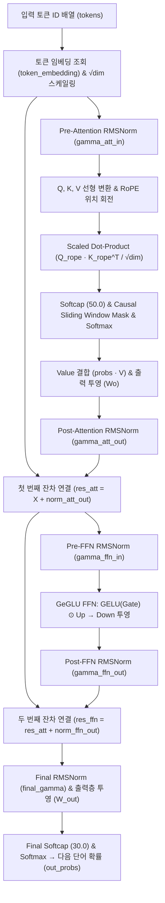

# llm_study — Pure C Transformer (Gemma 2 Architecture) from Scratch

외부 머신러닝 라이브러리 없이 **순수 C언어 표준 라이브러리(`stdio.h`, `stdlib.h`, `math.h`)** 만으로 밑바닥부터 직접 구현한 **Gemma 2 스타일 트랜스포머(LLM) 순전파(Forward)·역전파(Backward)·학습(Training) 엔진**입니다.

---

## ✨ 주요 특징 (Key Features)

1. **순수 C언어 기반 밑바닥 구현 (Zero External Dependencies)**
   * 행렬 곱셈(`matmul`), 전치(`transpose`), 아다마르 곱(`hadamard`), 소프트맥스(`softmax`) 등 기초 선형대수 연산부터 직접 구현했습니다.
2. **Gemma 2 최신 아키텍처 기법 반영**
   * **Pre/Post RMSNorm**: 어텐션 및 FFN 서브 블록의 입력 전(Pre-Norm)과 출력 후(Post-Norm), 그리고 최종 출력층까지 총 5개의 `RMSNorm` 정규화 적용
   * **RoPE (Rotary Position Embedding)**: Query와 Key 벡터를 위치별로 회전시켜 상대적 위치 정보를 주입
   * **Attention & Logit Softcapping**: 어텐션 점수(`cap = 50.0`)와 최종 출력 로짓(`cap = 30.0`)에 $\text{cap} \cdot \tanh(x / \text{cap})$ 상한선을 적용해 수치 폭주 방지
   * **Causal + Sliding Window Mask**: 미래 토큰 참조를 차단하고 지정된 `window_size` 범위 내의 문맥만 집중하도록 마스킹
   * **GeGLU FFN**: `Gate`(GELU 활성화)와 `Up` 두 갈래 선형 변환을 아다마르 곱으로 결합한 뒤 `Down` 투영으로 차원을 복구하는 피드포워드 네트워크
3. **전 구간 수제 역전파 (Full Analytical Backpropagation)**
   * 자동 미분(Autograd) 프레임워크 없이 `Cross-Entropy + Softmax`, `Softcap`, `RMSNorm`, `GeGLU`, `RoPE`, `Scaled Dot-Product Attention`의 역전파 편미분 공식을 직접 유도·구현하여 14개의 가중치 텐서(단어 임베딩 표 포함)를 확률적 경사하강법(`SGD`)으로 학습합니다.

---

## 🏗️ 모델 아키텍처 흐름 (Architecture Overview)



---

## 📂 파일 구성 (File Structure)

| 파일명 | 설명 |
| :--- | :--- |
| **`llm.h`** | 4대 핵심 구조체(`Config`, `Weights`, `Activations`, `Gradients`) 정의 및 35개 전체 함수 선언 |
| **`llm.c`** | 기초 행렬 연산(12개), 트랜스포머 순전파 연산(5개), 역전파 미분 연산(6개), 가중치 초기화·SGD(4개), 블록 조립 및 전체 학습 엔진(8개) 구현 |
| **`main.c`** | 다음 단어 예측(Next-Token Prediction) 시나리오 학습 루프 및 학습 전·후 추론 결과 비교 실행 파일 |

---

## 🚀 빌드 및 실행 방법 (Build & Run)

수학 라이브러리(`math.h`) 링크를 위해 `-lm` 옵션을 붙여 컴파일합니다.

```bash
# 컴파일
gcc main.c llm.c -Wall -Wextra -lm -o llm

# 실행
./llm
```

---

## 📊 실행 결과 예시 (Sample Output)

무작위로 초기화된 가중치 상태에서 출발하여, 200 에폭(Epoch) 동안 스스로 단어 임베딩과 어텐션·FFN 가중치를 학습해 문장을 완성하는 결과입니다.

```text
=== [학습 전 예측] ===
입력: 나는       -> 예측: 나는       (정답: 오늘)
입력: 오늘       -> 예측: 나는       (정답: 점심으로)
입력: 점심으로 -> 예측: 나는       (정답: 김치찌개를)
입력: 김치찌개를 -> 예측: 나는       (정답: 먹었다.)

=== [학습 진행 중...] ===
Epoch   0 | Loss(오차): 1.940974
Epoch  40 | Loss(오차): 0.022705
Epoch  80 | Loss(오차): 0.009604
Epoch 120 | Loss(오차): 0.005899
Epoch 160 | Loss(오차): 0.004198
Epoch 200 | Loss(오차): 0.003234

=== [학습 후 예측] ===
입력: 나는       -> 예측: 오늘       (확률:  99.7% | 정답: 오늘)
입력: 오늘       -> 예측: 점심으로 (확률:  99.6% | 정답: 점심으로)
입력: 점심으로 -> 예측: 김치찌개를 (확률:  99.7% | 정답: 김치찌개를)
입력: 김치찌개를 -> 예측: 먹었다.   (확률:  99.7% | 정답: 먹었다.)
```
